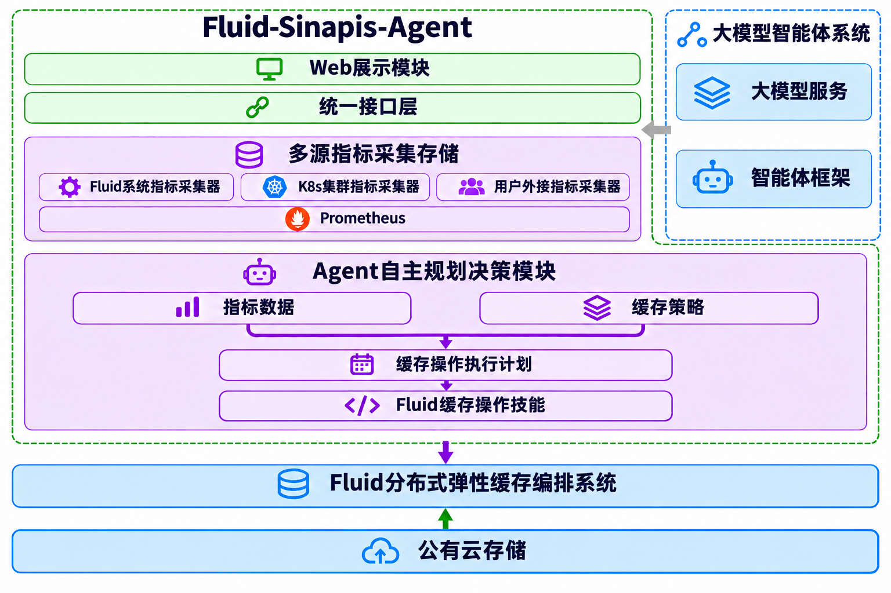

[English](README.md) | 简体中文

## 什么是Fluid-Sinapis-Agent
Fluid-Sinapis-Agent 是一套基于大模型智能体（AI Agent）框架构建的 Fluid 弹性缓存管理系统，其核心目标是将 Fluid 缓存管理从传统的“手工/规则式管理”升级为具备 Agentic（智能体自治）特征​ 的“自主感知‑智能决策‑自动执行”系统，实现缓存资源与业务节奏的动态精准匹配。

本系统通过多源指标数据定时感知 → LLM 诊断 → 选策略出方案 → LLM 复核 → 调 Fluid 执行 → 回检记录 形成一套完整的自治闭环，同时将业务侧的真实流量压力与 Fluid 的缓存效能指标关联起来，适配不同业务场景的差异化需求。
## 项目解决什么问题

一句话：它解决的是 Fluid 缓存“能弹性，但难以判断什么时候弹、该不该弹、该怎么弹”的问题。

Fluid 本身已经具备完整的弹性能力，但这些能力的“开关”都握在人手里。​ 系统知道“怎么扩”，却不知道“该不该扩、扩多少、先预热还是先加副本”。

### 项目职责边界
+ 不替代 Fluid 自身的缓存引擎（Alluxio / JuiceFS等）和数据编排能力
+ 不替代 Prometheus 采集、K8s 调度这些基础设施
+ 不处理底层存储故障、网络分区等系统性故障

## 核心功能

- __多源指标数据采集存储__

  可插拔采集器类，拉取 Fluid 原生 Metrics 与 K8s Metrics API（Pod/节点资源），统一封装成 Prometheus Metric 落库；新增采集器是在 `server/collectors/run_collectors.py` 注册一个类。业务流量数据无需改核心代码：在 `config.yml` 的 `user_system` 段声明后经 HTTP 推送接入

- __大模型智能体系统数据接入（被动推送）__

  无法主动拉取的数据由用户系统主动 POST 过来，服务端校验后写入 Prometheus。**`server/config.yml` 的 `user_system` 段修改无需重启**（按文件修改时间检测，约 1 秒内生效）；其余段修改需重启。详见：[用户自定义策略与指标接入](docs/zh/custom-strategies-and-metrics.md)

- __Agent Loop 自主决策__

	周期读取时序指标（间隔由 `agent.interval_seconds` 决定，默认 10 秒）→ 封装状态快照 → LLM 推理生成结构化执行计划 → LLM 二次校验 → 确定性执行器调用 Fluid 操作技能 → 记录结构化执行结果。

- __Fluid缓存操作Skill__

  提供多种Fluid缓存操作skill，包括缓存文件预加载（DataLoad）、缓存文件按近似 LRU 移除（只清缓存副本）、缓存容量扩容与缩容等。

- __缓存策略可扩展__

	内置缓存策略用 Prompt 定义；用户自定义缓存策略按照skill规范编写python脚本，定时扫描自定义策略并加载、免重启

### 关键亮点
双模型校验：计划生成后还要过一次 LLM 校验（结合状态、策略约束、Fluid 操作规范），相当于“处方先复核再下药”，压住大模型幻觉带来的误操作风险。

## 项目运行依赖
用户下载本项目后，要在本地准备好运行项目所需要的依赖环境：

+ Node.js >=20.19（可选，仅构建 Web 控制台需要） ，  [官网地址](https://nodejs.org/zh-cn)  
+ Prometheus >= 2.x  ，  [官网地址](https://prometheus.io/docs/prometheus/latest/getting_started/)  
+ Python >= 3.12  ，  [官网地址](https://www.python.org/)  
+ Kubernetes 集群 >= 1.30  ，  [官网地址](https://kubernetes.io/)  
+ Fluid 系统 >= 1.0.8  ，  [官网地址](https://github.com/fluid-cloudnative/fluid/blob/master/docs/zh/userguide/install.md)  
+ 大语言模型（[SinapisAI](https://mio.sinapisai.com)、[DeepSeek](https://platform.deepseek.com/sign_in)、[GLM](https://bigmodel.cn/) 等OpenAI兼容接口），建议使用SinapisAI 

> 完整的下载、安装与配置说明见[用户使用文档](docs/zh/user-guide.md)。

## 文档

| 文档 | 中文 | English |
|---|---|---|
| 快速开始 | [docs/zh/quick-start.md](docs/zh/quick-start.md) | [docs/en/quick-start.md](docs/en/quick-start.md) |
| 用户使用文档（下载 / 安装 / 配置 / 启动） | [docs/zh/user-guide.md](docs/zh/user-guide.md) | [docs/en/user-guide.md](docs/en/user-guide.md) |
| 自定义策略与指标使用 | [docs/zh/custom-strategies-and-metrics.md](docs/zh/custom-strategies-and-metrics.md) | [docs/en/custom-strategies-and-metrics.md](docs/en/custom-strategies-and-metrics.md) |
| Example（用户系统模拟器）使用 | [docs/zh/example-usage.md](docs/zh/example-usage.md) | [docs/en/example-usage.md](docs/en/example-usage.md) |

## 快速开始
你可以通过 [快速开始](docs/zh/quick-start.md) 在Kubernetes集群中测试Fluid-Sinapis-Agent（最短路径，五步跑通）；完整的下载、安装、配置与启动说明见 [用户使用文档](docs/zh/user-guide.md).

## 欢迎加入与反馈
Fluid-Sinapis-Agent让Fluid真正具有Agent自治的能力，开源只是一个起点，需要大家的共同参与。大家在使用过程发现Bug或需要的Feature，都可以直接在 [GitHub](https://github.com/fluid-cloudnative/fluid-sinapis)上面提 issue 或 PR，一起参与讨论。

## 开源协议
Fluid-Sinapis-Agent采用Apache 2.0 license开源协议，详情参见[LICENSE](./LICENSE)文件。

## 行为准则
Fluid-Sinapis-Agent 遵守 [CNCF 行为准则](https://github.com/cncf/foundation/blob/main/code-of-conduct.md)。
