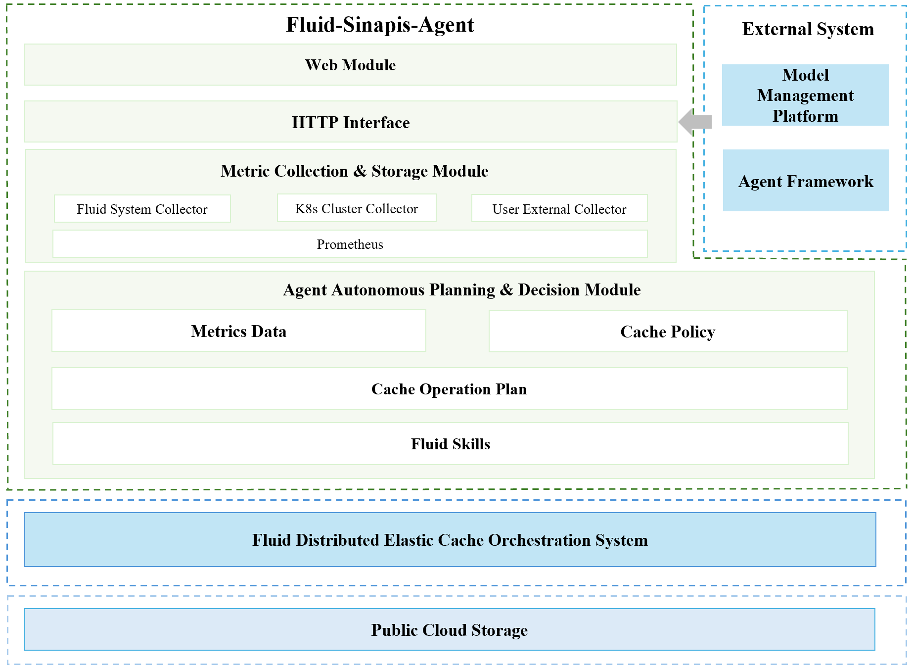

## What is Fluid-Sinapis-Agent

Fluid-Sinapis-Agent is an elastic Fluid cache management system built on an AI-agent framework, whose core goal is to upgrade Fluid cache management from traditional "manual/rule-based management" to an "autonomous perception – intelligent decision-making – automatic execution" system with Agentic characteristics, matching cache resources precisely and dynamically with the rhythm of the business.

    

The system forms a complete autonomy loop: scheduled multi-source metric collection → LLM diagnosis → strategy selection and plan generation → LLM review → Fluid execution → result verification, while correlating real business traffic pressure with Fluid cache efficiency metrics to fit the differentiated needs of different business scenarios.

## What Problem Does It Solve

In one sentence: it solves the problem that Fluid caches "can scale elastically, but it is hard to tell when to scale, whether to scale, and how to scale".

Fluid already has complete elastic capabilities, but the "switches" of these capabilities are held by humans. The system knows "how to scale", but not "whether to scale, how much to scale, and whether to preload first or add replicas first".

### Scope of Responsibility

+ Does not replace Fluid's own cache engine (Alluxio / JuiceFS, etc.) or its data orchestration capabilities
+ Does not replace infrastructure such as Prometheus collection and K8s scheduling
+ Does not handle systematic failures such as underlying storage faults or network partitions

## Features

- __Multi-source metric collection and storage__

  Pluggable collector classes pull Fluid native metrics and the K8s Metrics API (pod/node resources), unified as Prometheus metrics for storage; a new collector is a class registered in `server/collectors/run_collectors.py`. External business traffic data needs no core change: it is declared in the `user_system` section of `config.yml` and pushed over HTTP

- __LLM agent system data ingestion (passive push)__

  Data that cannot be pulled actively is POSTed by the user system, validated server-side, and written into Prometheus. **The `user_system` section of `server/config.yml` hot-reloads without a restart** (detected by file mtime, effective within about 1 second); every other section requires a restart. detail: [custom-strategies-and-metrics](docs/en/custom-strategies-and-metrics.md):

- __Agent Loop autonomous decision-making__

  Reads time-series metrics periodically (per `agent.interval_seconds`, default 10 seconds) → wraps a state snapshot → LLM reasoning produces a structured execution plan → second LLM validation → the deterministic executor invokes Fluid operation skills → structured execution results are recorded.

- __Fluid cache operation skills__

  Multiple Fluid cache operation skills are provided: cache file preloading (DataLoad), approximate-LRU cache file eviction (clears cached copies only), cache capacity expansion, and cache capacity shrinking.

- __Extensible cache strategies__

  Built-in cache strategies are defined by prompts; user-defined cache strategies are written as Python scripts following the skill specification, scanned, loaded periodically, and effective without restart.

### Key Highlights

Dual-model validation: after a plan is generated it must pass an independent LLM review (combining status, strategy constraints, and Fluid operation rules) — "prescription reviewed before the drug is administered" — to suppress the risk of misoperation caused by model hallucination.

## Runtime Dependencies

After downloading the project, prepare the following environment:

+ Node.js >= 20.19 (optional, only to build the web console), [official site](https://nodejs.org/en)
+ Prometheus >= 2.x, [official site](https://prometheus.io/docs/prometheus/latest/getting_started/)
+ Python >= 3.12, [official site](https://www.python.org/)
+ Kubernetes cluster >= 1.30, [official site](https://kubernetes.io/)
+ Fluid >= 1.0.8, [installation guide](https://github.com/fluid-cloudnative/fluid/blob/master/docs/zh/userguide/install.md)
+ A large language model ([SinapisAI](https://mio.sinapisai.com), [DeepSeek](https://platform.deepseek.com/sign_in), [GLM](https://bigmodel.cn/), or any OpenAI-compatible endpoint); SinapisAI is recommended

> See the [User Guide](docs/en/user-guide.md) for the full walkthrough.

## Documentation

| Document | English | 
|---|---|
| Quick start | [docs/en/quick-start.md](docs/en/quick-start.md) | 
| User guide (download / install / configure / start) | [docs/en/user-guide.md](docs/en/user-guide.md) | 
| Custom strategies & metrics | [docs/en/custom-strategies-and-metrics.md](docs/en/custom-strategies-and-metrics.md) | 
| Example (user-system simulator) | [docs/en/example-usage.md](docs/en/example-usage.md) | 

## Quick Start

Follow the [Quick Start](docs/en/quick-start.md) (shortest path, five steps) to test
Fluid-Sinapis-Agent on your Kubernetes cluster; for the full download/install/configure/start
walkthrough see the [User Guide](docs/en/user-guide.md). 

## Join Us and Give Feedback

Fluid-Sinapis-Agent brings true agent autonomy to Fluid, and open source is only the starting point. If you find bugs or want new features while using it, please open an issue or PR on [GitHub](https://github.com/fluid-cloudnative/fluid-sinapis) and join the discussion.

Slack:  
- Join in the [CNCF](https://cncf-slack.netlify.app/) Slack and navigate to the #fluid channel for discussion.

## License

Fluid-Sinapis-Agent is licensed under the Apache 2.0 license. See the [LICENSE](./LICENSE) file for details.

## Code of Conduct

Fluid-Sinapis-Agent follows the [CNCF Code of Conduct](https://github.com/cncf/foundation/blob/main/code-of-conduct.md).
